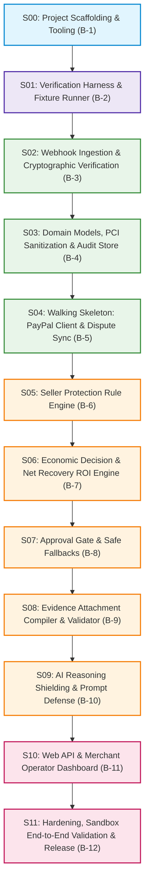

# Implementation Stage Plan: DisputeSentry AI

## 1. Overview and De-risking Rationale

The DisputeSentry AI implementation decomposes the 12 roadmap checkpoints (B-1 through B-12) and 22 behavior catalog items (`DSP001` - `DSP022`) into 12 discrete, single-session stages (`S00` to `S11`).

### Ordering and De-Risking Strategy
1. **Tooling & Ground Truth First (`S00`, `S01`)**: No catalog implementation begins before the test runner and golden fixture verification harness are operational. This guarantees every subsequent commit is mechanically verified against ground truth from [ADR-004](file:///D:/fix/challenges/paypal/docs/adr/ADR-004-verification-strategy.md).
2. **Ingestion & Data Core (`S02`, `S03`)**: High-throughput cryptographic signature verification and local data modeling (with strict PCI DSS sanitization) are built first to establish clean boundaries for all incoming dispute events.
3. **Early Walking Skeleton (`S04`)**: Before deep domain rules (Seller Protection, ROI models, LLM shielding) are written, an end-to-end vertical slice is completed: inbound webhook ingestion, order retrieval, response deadline calculation, and PayPal Disputes API provide-evidence dispatch. This surfaces client integration issues early when fixes are cheap.
4. **Domain Intelligence Expansion (`S05`, `S06`)**: Deterministic Seller Protection rules and the Net Expected Recovery economic engine are layered on top of verified domain structures.
5. **Safety, Oversight & Constraints (`S07`, `S08`, `S09`)**: High-value approval locks ($100+), attachment MIME/size validators, and prompt injection shields isolate the core engine from external exploits or unauthorized concessions.
6. **Interface, Hardening & Release (`S10`, `S11`)**: The merchant operator dashboard and end-to-end sandbox validation complete the delivery surface.

---

## 2. Mermaid Dependency Graph

---

## 3. Critical Path Analysis

The critical path spans all 12 stages in direct sequence:
$$\text{S00} \rightarrow \text{S01} \rightarrow \text{S02} \rightarrow \text{S03} \rightarrow \text{S04} \rightarrow \text{S05} \rightarrow \text{S06} \rightarrow \text{S07} \rightarrow \text{S08} \rightarrow \text{S09} \rightarrow \text{S10} \rightarrow \text{S11}$$

- **Primary Bottleneck:** S04 (Walking Skeleton). Once S04 passes, all core protocol and PayPal communication boundaries are proven.
- **Secondary Bottleneck:** S09 (AI Shielding). Ensures untrusted customer text cannot execute prompt injection overrides.

---

## 4. Stage Specifications

### S00: Project Scaffolding & Tooling
- **Goal:** Establish Python 3.11+ workspace, pinned dependencies, configuration parser, and lint/formatting pipelines.
- **Depends on:** None
- **Outcome:** Clean project structure where `pytest` and `ruff` pass with zero configuration warnings.
- **Catalog IDs:** None (Scaffolding prerequisite)
- **Roadmap Checkpoint:** B-1
- **Risk:** Low (standard environment setup).
- **Files Owned:** `pyproject.toml`, `requirements.txt`, `.gitignore`, `config.yaml`, `app/__init__.py`, `app/config.py`, `tests/__init__.py`, `tests/conftest.py`.

### S01: Verification Harness & Fixture Runner
- **Goal:** Implement the automated oracle test runner capable of loading all 22 catalog item fixtures and verifying outputs against ground truth contracts.
- **Depends on:** S00
- **Outcome:** `pytest tests/test_catalog_fixtures.py` executes and validates schema conformance and fixture presence across all 22 items.
- **Catalog IDs:** None (Test harness prerequisite)
- **Roadmap Checkpoint:** B-2
- **Risk:** Medium (must support both JSON and YAML ground truth comparisons without schema drift).
- **Files Owned:** `tests/harness/`, `tests/test_catalog_fixtures.py`.

### S02: Webhook Ingestion & Cryptographic Verification Core
- **Goal:** Build the FastAPI `/webhooks/paypal` endpoint with RSA-SHA256 signature verification, X.509 cert domain validation, and deduplication.
- **Depends on:** S01
- **Outcome:** Inbound webhook payloads verified cryptographically with invalid/tampered requests rejected with 400/401.
- **Catalog IDs:** `DSP001`, `DSP002`, `DSP003`, `DSP004`
- **Roadmap Checkpoint:** B-3
- **Risk:** High (cryptographic signature verification and certificate URL SSRF protection).
- **Files Owned:** `app/clients/webhook_verifier.py`, `app/api/webhooks.py`.

### S03: Domain Models, PCI Sanitization & Audit Store
- **Goal:** Define Pydantic v2 domain models, SQLite WAL database, PCI DSS cardholder data scrubber, and append-only tamper-evident audit store.
- **Depends on:** S02
- **Outcome:** Order and dispute persistence with seeded records, zero PAN/CVV leakage, and SHA-256 chained audit entries.
- **Catalog IDs:** `DSP006`, `DSP019`, `DSP022`
- **Roadmap Checkpoint:** B-4
- **Risk:** High (PCI DSS compliance and audit record immutability).
- **Files Owned:** `app/models/`, `app/storage/`, `app/services/sanitizer.py`, `app/services/audit_service.py`.

### S04: Walking Skeleton: PayPal Client & Dispute Sync
- **Goal:** Deliver an end-to-end slice connecting webhook ingestion to local order lookup, deadline urgency calculation, and PayPal Disputes API provide-evidence call.
- **Depends on:** S03
- **Outcome:** Ingested dispute triggers order lookup, validates HATEOAS links, computes response due date, and submits evidence via mocked PayPal client.
- **Catalog IDs:** `DSP005`, `DSP010`, `DSP014`
- **Roadmap Checkpoint:** B-5
- **Risk:** High (OAuth2 token lifecycle, HATEOAS link adherence, and end-to-end integration).
- **Files Owned:** `app/clients/paypal_client.py`, `app/services/dispute_sync.py`.

### S05: Seller Protection Rule Engine
- **Goal:** Implement deterministic rule evaluation for Item Not Received (INR), Unauthorised transactions, and Not As Described (SNAD) disputes.
- **Depends on:** S04
- **Outcome:** Seller Protection eligibility determined strictly matching PayPal policy rules.
- **Catalog IDs:** `DSP007`, `DSP008`, `DSP009`
- **Roadmap Checkpoint:** B-6
- **Risk:** Medium (handling edge cases in carrier delivery statuses and address matching).
- **Files Owned:** `app/domain/seller_protection.py`.

### S06: Economic Decision & Net Recovery ROI Engine
- **Goal:** Implement Net Expected Recovery equation ($\text{EV}$), inquiry stage settlement logic, and historical recovery audit metrics.
- **Depends on:** S05
- **Outcome:** Quantitative recommendation (`CONTEST`, `CONCEDE`, `INQUIRY_OFFER`) generated based on mathematical expectation.
- **Catalog IDs:** `DSP011`, `DSP012`, `DSP021`
- **Roadmap Checkpoint:** B-7
- **Risk:** Medium (floating-point precision and boundary threshold behavior).
- **Files Owned:** `app/domain/economics.py`, `app/services/metrics_service.py`.

### S07: Human-in-the-Loop Approval Gate & Safe Fallbacks
- **Goal:** Enforce financial safety locks for disputes $\ge \$100$ and automate fail-safe defense within 2 hours of deadline expiry.
- **Depends on:** S06
- **Outcome:** High-value concessions locked until explicit operator approval; automated fallback prevents default loss on unapproved actions.
- **Catalog IDs:** `DSP013`, `DSP015`, `DSP018`
- **Roadmap Checkpoint:** B-8
- **Risk:** High (financial concession safety and deadline countdown reliability).
- **Files Owned:** `app/services/approval_gate.py`, `app/services/deadline_monitor.py`.

### S08: Evidence Attachment Compiler & Validation
- **Goal:** Package, sanitize, and validate file attachments (max 10 MB per file, max 50 MB total, JPG/PNG/PDF) for multipart PayPal submission.
- **Depends on:** S07
- **Outcome:** Multipart/related or multipart/form-data payloads formatted and rejected on size/MIME violations before upload.
- **Catalog IDs:** `DSP016`, `DSP017`
- **Roadmap Checkpoint:** B-9
- **Risk:** Medium (multipart MIME boundary encoding and byte-size enforcement).
- **Files Owned:** `app/services/evidence_compiler.py`.

### S09: AI Reasoning Shielding & Prompt Injection Defense
- **Goal:** Implement structured Gemini reasoning with Pydantic output schemas, XML boundary wrapping, and adversarial prompt injection defenses.
- **Depends on:** S08
- **Outcome:** Customer dispute text safely analyzed; adversarial override attempts neutralized while returning valid structured JSON.
- **Catalog IDs:** `DSP020`
- **Roadmap Checkpoint:** B-10
- **Risk:** High (adversarial jailbreak and prompt injection resistance).
- **Files Owned:** `app/clients/ai_client.py`, `app/domain/reasoning_shield.py`.

### S10: Web API & Merchant Operator Dashboard
- **Goal:** Provide responsive web interface for merchant operators with deadline countdowns, queue sorting, approval actions, and audit inspection.
- **Depends on:** S09
- **Outcome:** Real-time web UI rendered with Jinja2 templates; operator can review pending disputes and trigger approvals.
- **Catalog IDs:** None (User Interface Delivery Surface)
- **Roadmap Checkpoint:** B-11
- **Risk:** Low (standard Jinja2 templates and Tailwind CSS).
- **Files Owned:** `app/api/dashboard.py`, `app/templates/`, `app/static/`.

### S11: System Hardening, Sandbox End-to-End Validation & Release
- **Goal:** Verify system against live PayPal Sandbox APIs across all dispute reasons, validate containerization, and prepare submission artifacts.
- **Depends on:** S10
- **Outcome:** 100% green test suite across mock and sandbox fixtures; Docker container starts cleanly; README run instructions validated.
- **Catalog IDs:** None (Release & Verification Milestone)
- **Roadmap Checkpoint:** B-12
- **Risk:** Medium (live sandbox network flakiness and environment configuration).
- **Files Owned:** `Dockerfile`, `docker-compose.yaml`, `README.md`, `run_sandbox_eval.py`.

---

## 5. Traceability Matrix

| Catalog ID | Title | Stage | Checkpoint | Risk |
|---|---|---|---|---|
| `DSP001` | Verify valid PayPal webhook signature | S02 | B-3 | High |
| `DSP002` | Reject tampered webhook signature | S02 | B-3 | High |
| `DSP003` | Deduplicate webhook transmission ID | S02 | B-3 | Medium |
| `DSP004` | Validate certificate URL domain whitelist | S02 | B-3 | High |
| `DSP005` | Validate HATEOAS link preconditions | S04 | B-5 | High |
| `DSP006` | Lookup matching merchant order & tracking | S03 | B-4 | Low |
| `DSP007` | INR Seller Protection delivery verification | S05 | B-6 | Medium |
| `DSP008` | Unauthorised dispute shipment date check | S05 | B-6 | Medium |
| `DSP009` | SNAD dispute refund / return policy check | S05 | B-6 | Medium |
| `DSP010` | Response deadline urgency calculation | S04 | B-5 | Low |
| `DSP011` | Net Expected Recovery ROI decision | S06 | B-7 | Medium |
| `DSP012` | Inquiry stage messaging & settlement offer | S06 | B-7 | Low |
| `DSP013` | High-value ($100+) approval gate | S07 | B-8 | High |
| `DSP014` | Provide-evidence API dispatch | S04 | B-5 | High |
| `DSP015` | Accept-claim API concession execution | S07 | B-8 | High |
| `DSP016` | Attachment file size constraints | S08 | B-9 | Low |
| `DSP017` | Attachment MIME type validation | S08 | B-9 | Low |
| `DSP018` | 2-hour deadline fail-safe fallback | S07 | B-8 | High |
| `DSP019` | PCI DSS PAN and CVV scrubbing | S03 | B-4 | High |
| `DSP020` | Prompt injection neutralization | S09 | B-10 | High |
| `DSP021` | Net recovery vs win rate audit metrics | S06 | B-7 | Low |
| `DSP022` | Tamper-evident append-only audit trail | S03 | B-4 | High |
