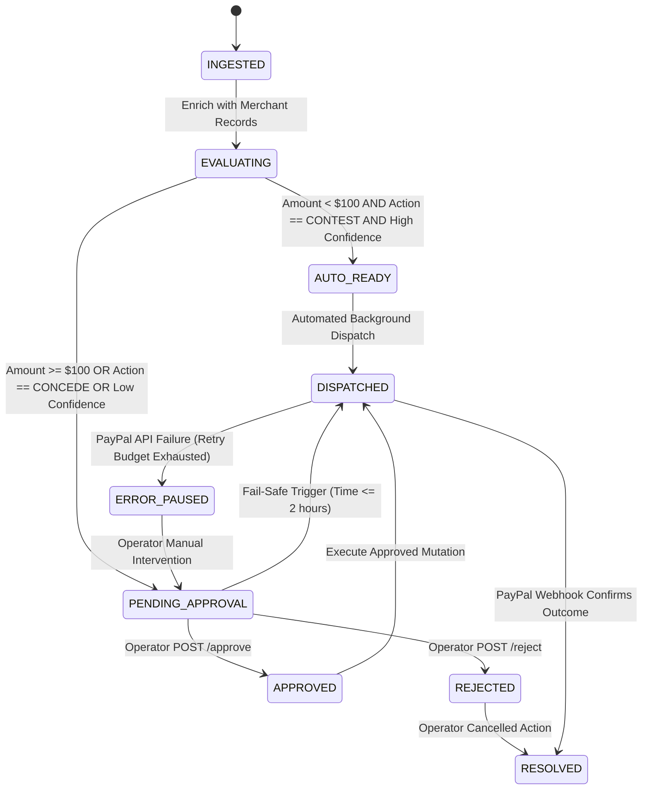

# Human-in-the-Loop Approval Gate and State Machine

This document defines the formal finite state machine (FSM) governing operator oversight, approval locks for financial concessions, and deadline fail-safe fallbacks.

---

## 1. State Machine Diagram

---

## 2. Transition Guard Rules

1. **Strict Human Gate:** A dispute with amount $\ge \$100.00$ or recommended action `CONCEDE` can NEVER transition directly to `DISPATCHED` via automated background workers, UNLESS the deadline fail-safe triggers.
2. **2-Hour Fail-Safe Emergency Rule (`DSP018`):** If a dispute remains in `PENDING_APPROVAL` with `hours_until_due <= 2.0`, the system automatically transitions state to `DISPATCHED` and uploads the assembled evidence package to avoid automatic default forfeiture by PayPal.
3. **Audit Trail Guarantee:** Every state transition must generate an append-only, SHA-256 chained entry in the audit store before acknowledging the HTTP request.
