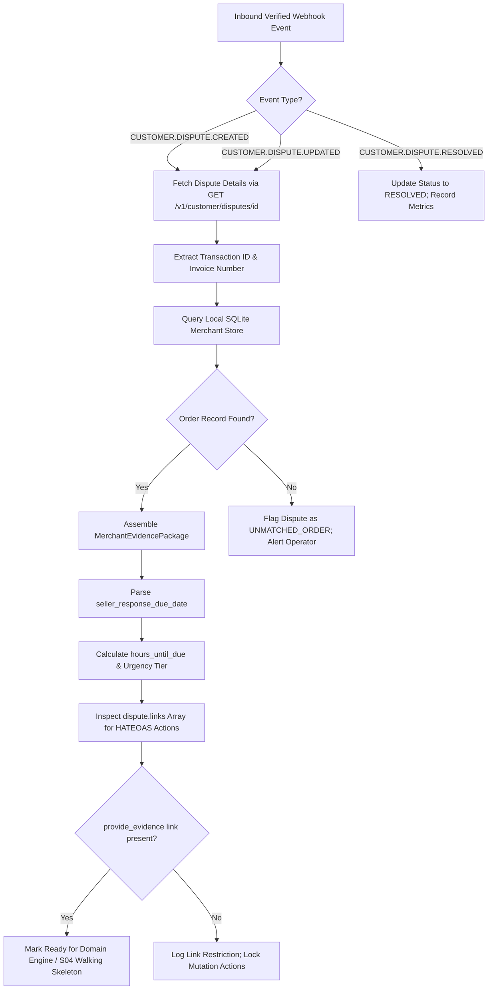

# Dispute Synchronization and Walking Skeleton Flow

This document details the lifecycle of an ingested dispute, from initial webhook trigger through merchant record linking, HATEOAS verification, and response urgency tracking.

---

## 1. Flow Diagram

---

## 2. Urgency Tiers based on `seller_response_due_date`

| Time Remaining (`hours_until_due`) | Urgency Classification | System Behavior |
|---|---|---|
| `> 72 hours` | `LOW` | Normal evaluation queue; human review window open. |
| `24 to 72 hours` | `MEDIUM` | Visual warning on dashboard; highlighted in review queue. |
| `2 to 24 hours` | `CRITICAL` | Operator alert; prioritized at top of approval list. |
| `≤ 2 hours` | `FAIL_SAFE_EMERGENCY` | Auto-dispatch defensive evidence package to prevent default forfeiture. |
