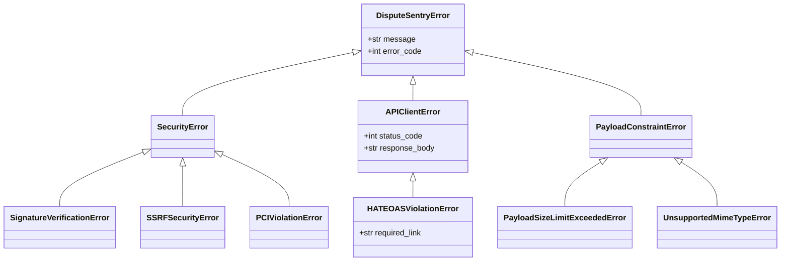

# Error Taxonomy and Recovery Flow

This document maps all expected exception classes, HTTP error statuses, and system recovery procedures across DisputeSentry AI.

---

## 1. Exception Class Hierarchy

---

## 2. HTTP Error Response Mapping

| Exception Class | HTTP Status Code | Response Payload Summary | Action / Recovery |
|---|---|---|---|
| `SSRFSecurityError` | `400 Bad Request` | `{"error": "INVALID_CERT_URL"}` | Reject inbound webhook immediately; do not fetch cert. |
| `SignatureVerificationError` | `401 Unauthorized` | `{"error": "INVALID_SIGNATURE"}` | Reject unverified request; log warning. |
| `HATEOASViolationError` | `409 Conflict` | `{"error": "ACTION_NOT_PERMITTED"}` | Dispute stage progressed; refresh dispute details from PayPal. |
| `PayloadSizeLimitExceededError` | `413 Payload Too Large` | `{"error": "FILE_EXCEEDS_10MB"}` | Reject evidence upload before calling PayPal API. |
| `UnsupportedMimeTypeError` | `415 Unsupported Media Type` | `{"error": "UNSUPPORTED_MIME_TYPE"}` | Reject non-JPG/PNG/PDF attachments. |
| `UnmatchedOrderError` | `404 Not Found` | `{"error": "ORDER_NOT_FOUND"}` | Flag dispute for manual merchant investigation. |
