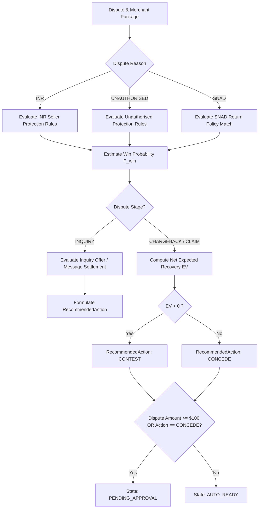

# Evaluation and Economic Decision Flow

This document defines the mathematical and policy logic applied by `app/domain/seller_protection.py` and `app/domain/economics.py` to determine the recommended action.

---

## 1. Flow Diagram

---

## 2. Quantitative Equation: Net Expected Recovery

$$\text{EV} = (P_{\text{win}} \cdot A) - ((1 - P_{\text{win}}) \cdot F) - C$$

Where:
- $A$: Disputed Transaction Amount (e.g., $\$149.99$).
- $P_{\text{win}}$: Estimated Probability of Winning (bounded $[0.0, 1.0]$) derived from Seller Protection and tracking proof.
- $F$: Non-refundable Dispute Fee (e.g., $\$15.00$).
- $C$: Internal Overhead Cost to Contest (e.g., $\$5.00$).

### Decision Rule
- If $\text{EV} > 0$: Recommend `CONTEST`.
- If $\text{EV} \le 0$: Recommend `CONCEDE` (unless operator explicitly overrides).
