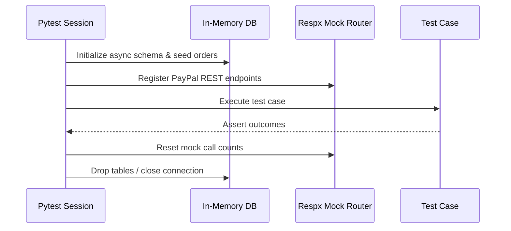

# Integration Test Harness and Environment Lifecycle

This document governs the setup, execution, isolation, and teardown of the integration test environment.

---

## 1. Zero Network Dependency Guarantee

- All Tier 1, 2, and 3 tests run entirely offline.
- External PayPal endpoints are mocked using `respx.mock` with explicit JSON payloads derived from PayPal OpenAPI documentation.
- The Google GenAI SDK is mocked with deterministic returns or executes against a local rule-based surrogate engine when `DSP_ENV=test`.

---

## 2. In-Memory SQLite Isolation

- Each pytest session or test class uses an isolated in-memory SQLite database (`sqlite+aiosqlite:///:memory:`).
- Database migrations and schema creation execute automatically in `tests/conftest.py` before each test function.
- WAL mode simulation ensures concurrent reader/writer isolation is validated without leaving lingering `.db` or `.db-wal` files on disk.

---

## 3. Test Lifecycle & Cleanup

